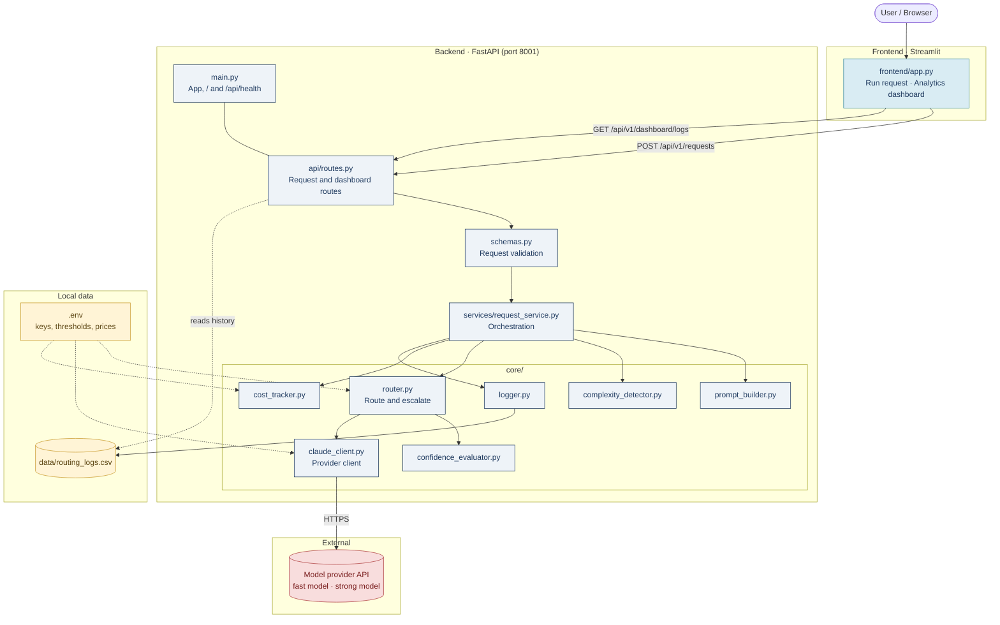
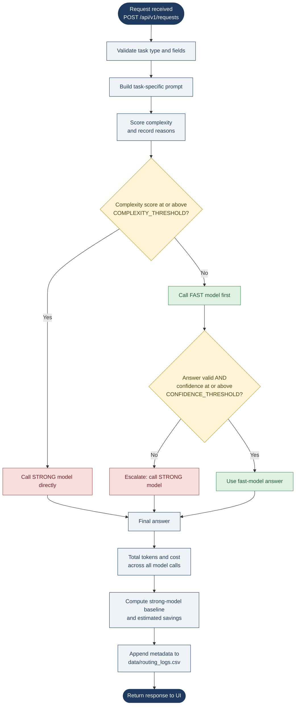
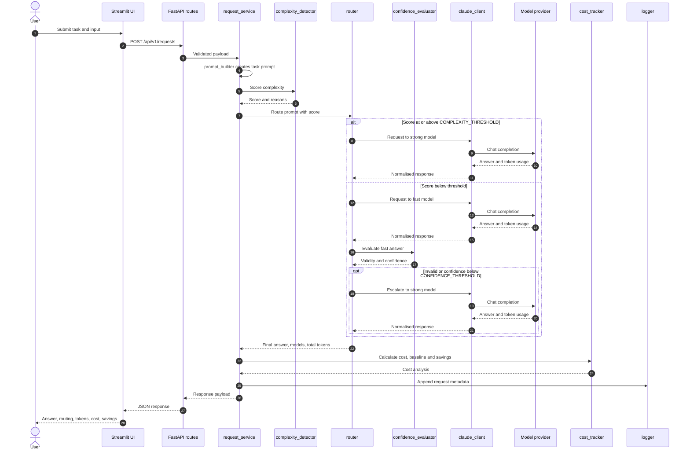
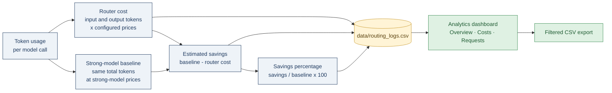
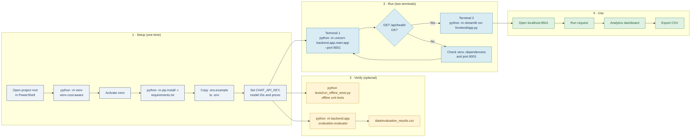

<div align="center">

# Cost-Aware Multi-Model Router

**Route every AI request to the cheapest model that can answer it well, and escalate only when needed.**


</div>

A full-stack AI application that routes classification, extraction, summarisation, and question-answering requests through a FastAPI backend. It tries a lower-cost model first for suitable tasks and escalates to a stronger model when task complexity or the fast model's result requires it.

The Streamlit frontend lets users submit requests and explore routing, token, cost, and savings analytics. Costs are estimates calculated from the prices configured for the selected models.

---

## Table of contents

1. [Overview](#overview)
2. [Features](#features)
3. [Tech stack](#tech-stack)
4. [Architecture](#architecture)
5. [Request workflow](#request-workflow)
6. [Routing logic](#routing-logic)
7. [Build and run pipeline](#build-and-run-pipeline)
8. [Project structure](#project-structure)
9. [Components](#components)
10. [Requirements](#requirements)
11. [Setup](#setup)
12. [Configuration](#configuration)
13. [Deploy on Render](#deploy-on-render)
14. [Run the application](#run-the-application)
15. [Using the application](#using-the-application)
16. [Supported tasks](#supported-tasks)
17. [API](#api)
18. [Cost calculation](#cost-calculation)
19. [Analytics dashboard](#analytics-dashboard)
20. [Offline evaluation and tests](#offline-evaluation-and-tests)
21. [Data and privacy](#data-and-privacy)
22. [Troubleshooting](#troubleshooting)
23. [Limitations](#limitations)
24. [More documentation](#more-documentation)

---

## Overview

Strong models are accurate but expensive. Many everyday tasks (tagging a support ticket, pulling fields out of a short text) do not need them. This project puts a small decision layer in front of the models:

1. Estimate how complex the task is.
2. Send simple tasks to a lower-cost **fast model**.
3. Check the fast model's answer for validity and confidence.
4. Escalate to the **strong model** only when the task is complex or the fast answer is not good enough.
5. Report tokens, estimated cost, and savings against an "always use the strong model" baseline.

## Features

- Four supported task types: classification, extraction, summarisation, and question answering.
- Complexity-aware routing and confidence-based escalation.
- FastAPI endpoints for model requests, health checks, and dashboard history.
- Streamlit interface with editable sample requests, request results, filters, dashboard views, and CSV export.
- Token-based estimated cost and savings calculations, including both calls when a request escalates.
- CSV request history that stores request metadata and input length, not the original user text.
- Separate offline strategy evaluation using a local dataset.

## Tech stack

| Layer | Technology | Role |
| --- | --- | --- |
| Frontend | Streamlit | Request form, results, analytics dashboard, CSV export |
| Backend | FastAPI + Uvicorn | REST API, validation, routing, costing |
| Models | Configurable provider (fast + strong model IDs) | Task execution |
| Storage | Local CSV (`data/routing_logs.csv`) | Request metadata for analytics |
| Config | `.env` | Keys, thresholds, model IDs, prices |
| Testing | Python `unittest` runner; pytest-compatible tests | Offline checks for core logic and routing |

## Architecture

The frontend communicates with FastAPI over HTTP. Provider credentials and model-routing logic stay in the backend process.



## Request workflow

Every request goes through the same pipeline: validate, build prompt, score complexity, route, evaluate, cost, and log.

### Routing decision flow



### End-to-end sequence



### Cost and savings pipeline



## Routing logic

The exact rules live in `backend/app/core/router.py`. Thresholds and prices are read from `.env`.

| Step | Condition | Result |
| --- | --- | --- |
| 1 | Task fails validation | Request rejected before any model call |
| 2 | Complexity score at or above `COMPLEXITY_THRESHOLD` | Strong model is called directly |
| 3 | Complexity below threshold | Fast model is tried first |
| 4 | Fast answer is valid and confidence is at or above `CONFIDENCE_THRESHOLD` | Fast answer is returned |
| 5 | Fast answer is invalid, or confidence is below `CONFIDENCE_THRESHOLD` | Escalate to the strong model |
| 6 | Escalation happened | Tokens and cost of both calls are totalled |

### Possible outcomes

| Outcome | Models called | Relative cost | Typical case |
| --- | --- | --- | --- |
| Direct strong | Strong only | Same as baseline (no savings) | Long or complex input |
| Fast accepted | Fast only | Lowest | Simple task, confident answer |
| Escalated | Fast, then strong | Fast cost plus strong cost | Simple-looking task, weak fast answer |

The confidence value is self-reported by the fast model. It is used as a routing signal and has not been calibrated as a probability or independently validated. Requests routed directly to the strong model do not run the fast-model confidence assessment, so their confidence is shown as unavailable. A direct strong-model route is recorded separately from an escalation.

Provider call failures on the fast-model path are recorded as failed requests and do not automatically trigger a strong-model call. This avoids an extra potentially chargeable call when provider authentication, availability, quota, or connectivity may affect both models. A successful provider call that returns a malformed or invalid fast-model response can still escalate to the strong model; that is an answer-quality fallback rather than a provider-error retry.

Complexity scoring uses task type and input length (`LONG_INPUT_THRESHOLD`, `VERY_LONG_INPUT_THRESHOLD`, `LONG_QA_CONTEXT_THRESHOLD`, `LONG_SUMMARISATION_THRESHOLD`) and records the reasons for the score.

### Complexity and confidence signals

Complexity is a deterministic heuristic; it does not call a model. It combines input length, reasoning keywords, multiple-instruction markers, task-specific long-context signals, and comparison keywords. The weights are 0.25 for length, 0.20 for reasoning, 0.15 for multiple instructions, 0.15 for task-specific complexity, 0.15 for comparison, and 0.10 for long context; the final score is capped at 1.0. A score at or above `COMPLEXITY_THRESHOLD` sends the request directly to the strong model. These keyword and length signals are explainable, but they can miss meaning expressed differently.

For requests below that threshold, the fast model returns an answer, a self-reported confidence from 0 to 1, and a `needs_escalation` flag. The router escalates if the response is malformed/invalid, its confidence is below `CONFIDENCE_THRESHOLD`, or the model explicitly asks for escalation. Self-reported confidence is not calibrated probability or an independent quality check.

## Build and run pipeline

From a fresh clone to a running application, with optional verification steps.



## Project structure

```text
cost-aware-model-router/
├── backend/
│   └── app/
│       ├── api/             # FastAPI routes
│       ├── core/            # Provider client, router, prompts, costing, logging
│       ├── evaluation/      # Offline strategy evaluation
│       ├── services/        # Request orchestration
│       ├── main.py          # FastAPI application
│       └── schemas.py       # Request validation
├── frontend/
│   └── app.py               # Streamlit interface and dashboard
├── data/
│   ├── test_dataset.json    # Offline evaluation input
│   ├── evaluation_results.csv  # Generated by the offline evaluator
│   ├── evaluation_cases.csv    # Per-case outcomes from the offline evaluator
│   └── routing_logs.csv     # Generated request metadata, when requests run
├── docs/
│   ├── architecture.md
│   └── project-guide.md
├── tests/                   # Core unit tests
├── .env.example             # Safe environment-variable template
└── requirements.txt
```

## Components

| Component | Responsibility |
| --- | --- |
| `frontend/app.py` | Streamlit UI, sample requests, result display, analytics filters, CSV export. Calls FastAPI over HTTP. |
| `backend/app/main.py` | Creates the FastAPI app and exposes the root and health endpoints. |
| `backend/app/api/routes.py` | Request and dashboard-log API routes. |
| `backend/app/schemas.py` | Validates incoming request fields and task names. |
| `backend/app/services/request_service.py` | Connects prompt construction, routing, cost analysis, and request logging. |
| `backend/app/core/prompt_builder.py` | Task-specific instructions for the four supported tasks. |
| `backend/app/core/complexity_detector.py` | Scores task complexity and records reasons. |
| `backend/app/core/confidence_evaluator.py` | Checks whether the fast-model answer is valid and confident enough. |
| `backend/app/core/router.py` | Selects the model, handles escalation, aggregates token usage, calculates request cost. |
| `backend/app/core/claude_client.py` | Sends requests to the configured provider and normalises responses and errors. |
| `backend/app/core/cost_tracker.py` | Estimates cost from token counts and configured per-model prices. |
| `backend/app/core/logger.py` | Appends request metadata to `data/routing_logs.csv`. |
| `backend/app/evaluation/evaluator.py` | Offline comparison of routing strategies using the evaluation dataset. |

## Requirements

- Python 3.10 or newer
- A provider API key for live model requests
- Internet access to the configured model provider

## Setup

### Windows (PowerShell)

Run these commands from the project root:

```powershell
python -m venv venv-cost-aware
.\venv-cost-aware\Scripts\Activate.ps1
python -m pip install --upgrade pip
python -m pip install -r requirements.txt
Copy-Item .env.example .env
```

### macOS / Linux (equivalent commands)

```bash
python3 -m venv venv-cost-aware
source venv-cost-aware/bin/activate
python -m pip install --upgrade pip
python -m pip install -r requirements.txt
cp .env.example .env
```

Open `.env` and set `CHAT_API_KEY`. Confirm the base URL and model IDs are available for your provider. Keep `.env` private; it is excluded from Git.

## Configuration

All settings are read from `.env`.

| Variable | Purpose |
| --- | --- |
| `CHAT_API_KEY` | Provider API credential. Keep secret. |
| `CHAT_BASE_URL` | Provider API origin. |
| `FAST_MODEL_ID` | Lower-cost model tried first for requests below the complexity threshold. |
| `STRONG_MODEL_ID` | Model for complex requests or escalation. |
| `CONFIDENCE_THRESHOLD` | Minimum fast-model confidence before escalation. |
| `COMPLEXITY_THRESHOLD` | Complexity score at which the strong model is called directly. |
| `MAX_OUTPUT_TOKENS` | Maximum output tokens requested per model call. |
| `FAST_INPUT_PRICE_PER_MTOK`, `FAST_OUTPUT_PRICE_PER_MTOK` | Fast-model prices in USD per million tokens. |
| `STRONG_INPUT_PRICE_PER_MTOK`, `STRONG_OUTPUT_PRICE_PER_MTOK` | Strong-model prices in USD per million tokens. |
| `LONG_INPUT_THRESHOLD`, `VERY_LONG_INPUT_THRESHOLD` | Input length thresholds used in complexity scoring. |
| `LONG_QA_CONTEXT_THRESHOLD`, `LONG_SUMMARISATION_THRESHOLD` | Task-specific long-context thresholds. |
| `ROUTER_API_URL` | Optional frontend setting for the FastAPI base URL; defaults to `http://127.0.0.1:8001`. |

### Deploy on Render

Deploy the backend and Streamlit frontend as two separate Render **Web Services**. Connect the `Neeleshsingh30/cost-aware-model-router` repository and select the `main` branch to deploy the current project version. Leave Root Directory blank (the repository root, `.`) for both services. This monorepo shares Python modules across its top-level folders, so do not set either service's root directory to `backend/` or `frontend/`.

**Backend service**

- Runtime: Python 3
- Build command: `pip install -r requirements.txt`
- Start command: `python -m uvicorn backend.app.main:app --host 0.0.0.0 --port $PORT`
- Health check path: `/api/health`

**Frontend service**

- Runtime: Python 3
- Build command: `pip install -r requirements.txt`
- Start command: `python -m streamlit run frontend/app.py --server.address 0.0.0.0 --server.port $PORT`

For each service, open its Render Dashboard page, select **Environment**, then add the variables below. Choose **Save, rebuild, and deploy** after adding them. Keep `CHAT_API_KEY` only on the backend service; set `ROUTER_API_URL` only on the frontend service to the deployed backend's public HTTPS URL (for example, `https://your-backend-name.onrender.com`, without an API path).

| Backend environment variables | Value |
| --- | --- |
| `CHAT_API_KEY` | Your provider key; enter it in Render's private environment variable field, never in source control. |
| `CHAT_BASE_URL` | Provider API origin, e.g. `https://api.experientiallabs.ai`. |
| `FAST_MODEL_ID`, `STRONG_MODEL_ID` | Model IDs enabled for your provider account. |
| `CONFIDENCE_THRESHOLD`, `COMPLEXITY_THRESHOLD`, `MAX_OUTPUT_TOKENS` | Numeric routing/generation settings from `.env.example`. |
| `FAST_INPUT_PRICE_PER_MTOK`, `FAST_OUTPUT_PRICE_PER_MTOK`, `STRONG_INPUT_PRICE_PER_MTOK`, `STRONG_OUTPUT_PRICE_PER_MTOK` | Current provider prices in USD per million tokens. |
| `LONG_INPUT_THRESHOLD`, `VERY_LONG_INPUT_THRESHOLD`, `LONG_QA_CONTEXT_THRESHOLD`, `LONG_SUMMARISATION_THRESHOLD` | Optional task-length thresholds; use the `.env.example` values or your chosen configuration. |

| Frontend environment variable | Value |
| --- | --- |
| `ROUTER_API_URL` | The backend service's public HTTPS base URL, with no trailing API path. |

Render sets `PORT` for each web service; the start commands bind to it. Configure environment variables through the service's **Environment** page, not by uploading or committing `.env`. See Render's [environment variable guide](https://render.com/docs/configure-environment-variables), [FastAPI deployment guide](https://render.com/docs/deploy-fastapi), and [monorepo guide](https://render.com/docs/monorepo-support).

### Provider integration verification

The backend uses the Anthropic Python SDK with Experiential Labs' Anthropic Messages lane. The SDK sends `POST /v1/messages` and authenticates with the `x-api-key` header; the configured origin remains `https://api.experientiallabs.ai` (do not append `/v1/messages` to `CHAT_BASE_URL`). SDK retries are disabled so a failed request is not silently resent by the client. Provider-side routing may still follow the model's configured gateway waterfall.

The configured model slugs `deepseek-v4-flash` and `gpt-6-sol` match the current [Experiential DeepSeek V4 Flash catalog entry](https://platform.experientiallabs.ai/models/deepseek-v4-flash) and [GPT-6 Sol catalog entry](https://platform.experientiallabs.ai/models/gpt-6-sol). Access for a particular API key depends on its organization; verify it with the authenticated `GET /v1/models` endpoint if a request reports that the model is unavailable. See Experiential's [Anthropic API](https://platform.experientiallabs.ai/docs/anthropic) and [authentication documentation](https://platform.experientiallabs.ai/docs/authentication).

Request validation limits `input_text` to 20,000 characters, `question` to 5,000, and the total request fields to 25,000 characters. If provider usage or either configured per-model token price is missing or malformed, cost fields are returned as unavailable instead of being reported as zero.

The values in `.env.example` are sample configuration. Update model IDs and prices to match your provider.

**Tuning tip:** a lower `COMPLEXITY_THRESHOLD` sends more requests straight to the strong model, and a higher `CONFIDENCE_THRESHOLD` escalates more fast-model answers. This can raise cost and may improve answer quality, but the effect depends on the task and models; compare settings with the offline evaluator.

## Run the application

Start the backend in the first terminal:

```powershell
cd "D:\vs code\Drf_project\cost-aware-model-router"
.\venv-cost-aware\Scripts\Activate.ps1
python -m uvicorn backend.app.main:app --host 127.0.0.1 --port 8001
```

Start the frontend in a second terminal:

```powershell
cd "D:\vs code\Drf_project\cost-aware-model-router"
.\venv-cost-aware\Scripts\Activate.ps1
python -m streamlit run frontend/app.py
```

| Service | URL |
| --- | --- |
| Streamlit UI | [http://localhost:8501](http://localhost:8501) |
| FastAPI health check | [http://127.0.0.1:8001/api/health](http://127.0.0.1:8001/api/health) |
| Interactive API docs | [http://127.0.0.1:8001/docs](http://127.0.0.1:8001/docs) |

To point Streamlit at a different backend, set `ROUTER_API_URL` before starting it.

## Using the application

1. Open **Run request** in the left navigation.
2. Select a **Task type**.
3. Optionally select **Try a sample request** to prefill an editable example.
4. Enter the input and any task-specific fields, then select **Run request**.
5. Review the answer, routing decision, token counts, estimated cost, baseline, and savings.
6. Open **Analytics dashboard** to explore Overview, Costs, and Requests. Use the filters and search to narrow the history; the Requests view can export filtered rows to CSV.

## Supported tasks

| Task | Required input | Behaviour |
| --- | --- | --- |
| Classification | Input text and allowed categories | Chooses one label from the supplied categories. |
| Extraction | Input text and field names | Returns the requested fields as JSON; missing information is `null`. |
| Summarisation | Input text | Produces a concise summary grounded in the supplied text. |
| Question answering | Context and question | Answers from the supplied context and states when the context is insufficient. |

## API

Interactive documentation is available at [http://127.0.0.1:8001/docs](http://127.0.0.1:8001/docs) while the backend is running.

| Method | Endpoint | Purpose |
| --- | --- | --- |
| `GET` | `/` | API landing response with endpoint links. |
| `GET` | `/api/health` | Backend health check. |
| `POST` | `/api/v1/requests` | Submit a task for model routing. |
| `GET` | `/api/v1/dashboard/logs` | Read request metadata for the dashboard. |

Example classification payload:

```json
{
  "task_type": "classification",
  "input_text": "I was charged twice for the same invoice.",
  "categories": ["billing", "technical", "account", "general"]
}
```

Example call:

```bash
curl -X POST http://127.0.0.1:8001/api/v1/requests \
  -H "Content-Type: application/json" \
  -d '{"task_type":"classification","input_text":"I was charged twice for the same invoice.","categories":["billing","technical","account","general"]}'
```

The request endpoint returns the answer, initial and final model, confidence and complexity values, escalation status, token usage, estimated actual cost, strong-model baseline, savings, and any error information. Check `/docs` for the exact response schema.

## Cost calculation

Configured model prices are USD per million tokens. The `.env.example` values are snapshots of the public Experiential catalog checked on **2026-10-15**: DeepSeek V4 Flash at $0.060 input / $0.12 output and GPT-6 Sol at $2 input / $10 output. See the [DeepSeek V4 Flash catalog](https://platform.experientiallabs.ai/models/deepseek-v4-flash) and [GPT-6 Sol catalog](https://platform.experientiallabs.ai/models/gpt-6-sol).

Experiential lists multiple provider routes for some model slugs, and their prices can differ by provider, account tier, or configured waterfall. These settings are therefore estimates, not a per-request billing feed. Check the catalog and your account before using the figures for budgeting, and update `.env` when your effective rates change.

```text
estimated cost     = (input tokens × input price + output tokens × output price) / 1,000,000
estimated savings  = strong-model baseline − router estimated cost
savings percentage = estimated savings / strong-model baseline × 100
```

If a request escalates, router cost adds the fast and strong calls separately using their configured prices. The strong-model baseline prices the combined token usage from both calls at the strong model's rates. If any required token usage or price is missing, the cost and savings are unavailable. If the strong baseline is zero, savings percentage is reported as 0% to avoid division by zero. Dashboard cost totals are shown as unavailable when any included request lacks a complete cost value, so failed or incomplete requests are not silently counted as free.

### Worked example (illustrative prices)

Assume fast = $0.25 input / $1.25 output and strong = $3 input / $15 output per million tokens, and each call uses 1,000 input and 200 output tokens.

| Scenario | Router cost | Strong baseline | Savings | Savings % |
| --- | --- | --- | --- | --- |
| Fast answer accepted | $0.0005 | $0.0060 | $0.0055 | 91.7% |
| Escalated (fast, then strong) | $0.0065 | $0.0120 | $0.0055 | 45.8% |

These prices are examples only. Use your provider's real prices in `.env`.

## Analytics dashboard

The dashboard loads metadata from `GET /api/v1/dashboard/logs`.

| View | What it shows |
| --- | --- |
| Overview | Request totals, success rate, fast-model share, escalations, cost and savings indicators, request/task/outcome charts. |
| Costs | Estimated router spend versus always using the strong model, and cumulative savings over time. |
| Requests | Searchable request details and a CSV download of the filtered history. |

Filters: final model, task type, escalated-only, and routing-reason/model search.

## Offline evaluation and tests

Run the strategy evaluation from the project root:

```powershell
python -m backend.app.evaluation.evaluator
```

It compares fast-only, strong-only, and cost-aware routing using the 40-case held-out `data/test_dataset.json` (10 examples per task). It writes summary rows to `data/evaluation_results.csv` and per-case outcomes to `data/evaluation_cases.csv`. Both outputs record the dataset hash and effective model/routing/pricing configuration. A full run makes at least 120 model calls; router escalations can raise the total to 160, so it may incur provider charges.

The test set is reserved for assessment; keep prompt-tuning examples in a separate development set. The repository currently has no development dataset, and its prior history cannot prove whether the held-out cases were previously used for tuning. Scoring uses exact normalized classification match, field-level extraction match, and token-level F1 for summarisation/Q&A. Token F1 is only lexical overlap, not a semantic or factuality judge; see [the evaluation protocol](docs/evaluation-protocol.md) for definitions and limitations.

The latest saved evaluation run used 40 examples (10 per task), model IDs `deepseek-v4-flash` and `gpt-6-sol`, and dataset SHA-256 `00dcbb9313dff65613e95fda0799ce282b794a563561fc3331aade19008dc79a` on 2026-10-15. Its recorded aggregate results were:

| Strategy | Accuracy | Successful / failed | Total estimated cost | Savings vs. always strong |
| --- | ---: | ---: | ---: | ---: |
| Always fast | 70.95% | 40 / 0 | $0.00035392 | 98.65% |
| Always strong | 76.16% | 40 / 0 | $0.02617600 | 0.00% |
| Cost-aware router | 71.32% | 39 / 1 | $0.00805373 | 69.23% |

This single 40-case run showed the router cost less than the strong-only baseline but scored 4.84 percentage points lower. Its accuracy uses 39 successful router cases; `extraction_05` failed because the fast model returned invalid JSON. The failure and its usage/cost are recorded per case. This is a small benchmark, not a guarantee of production quality or savings. That run made 129 model calls: 40 fast-only baseline calls, 40 strong-only baseline calls, 40 router first-stage calls, and 9 router escalations.

Run the complete offline test suite from the repository root:

```powershell
python tests/run_offline_tests.py
```

This Python standard-library runner includes the no-argument automated test functions and `unittest` cases. It does not need pytest or a live provider. The two manual provider scripts are excluded because they can make paid requests. If pytest is separately installed, `python -m pytest` can run the pytest-style tests as well. The focused audit coverage command is:

```powershell
python -m unittest discover -s tests -p test_task6_coverage.py -v
```

`tests/test_claude_client.py` and `tests/test_fast_confidence.py` are manual live-provider checks and are kept separate because they can make paid API requests. The evaluator is also a live assessment run and may incur provider charges.

## Data and privacy

Request history is stored locally in `data/routing_logs.csv`.

| Logged | Not logged |
| --- | --- |
| Task type, input length, model names, token counts, costs, confidence, escalation reason | The original user input text |

Security notes:

- Keep `.env` private and never commit it. Only `.env.example` belongs in Git.
- Provider credentials and routing logic stay on the backend; browser code never sees the API key.
- Avoid sharing API keys in screenshots, logs, or commits.

## Troubleshooting

| Symptom | What to check |
| --- | --- |
| Backend unavailable in the UI | Start FastAPI on port `8001` and open `http://127.0.0.1:8001/api/health`. |
| FastAPI reports a missing package | Activate `venv-cost-aware` and run `python -m pip install -r requirements.txt` in that environment. |
| Provider request fails | Check `CHAT_API_KEY`, `CHAT_BASE_URL`, model IDs, internet access, and provider API compatibility. Never print or share the API key while debugging. |
| Render logs show a connection to `localhost:5432` | This repository has no PostgreSQL client, database URL, database service, or database connection code. The only PostgreSQL reference is prose inside a synthetic evaluation example. The error therefore does not originate from this workspace's application code. Check that Render deploys `Neeleshsingh30/cost-aware-model-router`, branch `main`, repository-root directory, and the start command above; inspect that service's environment variables and complete deploy logs for an external or stale database configuration. No Render service settings or deploy logs are present in this workspace, so the external source cannot be identified further here. |
| Unexpected cost figures | Verify all four model price values in `.env` against the provider's current pricing. |
| Old entries remain in the dashboard | Analytics reads the persistent `data/routing_logs.csv`; archive or clear that file to reset history. |
| Windows DLL errors in charts/dataframes | The dashboard uses dependency-light rendering to avoid the affected binary chart/dataframe packages; avoid reintroducing those calls. |

## Limitations

- Costs and savings are **estimates** from configured prices, not provider billing data.
- Public catalog rates may differ from the provider route, account tier, or gateway waterfall used for a live request; keep the four configured prices current.
- Request history is a local CSV file, not a database.
- Render's local filesystem is ephemeral by default; request logs should not be assumed to persist across service replacement or restart. Configure a [persistent disk](https://render.com/docs/disks) at the log directory if local CSV persistence is required.
- Routing quality depends on the thresholds and prices you configure.
- Live requests call the provider and may incur charges.

## More documentation

- [Detailed project guide](docs/project-guide.md)
- [Architecture notes](docs/architecture.md)
